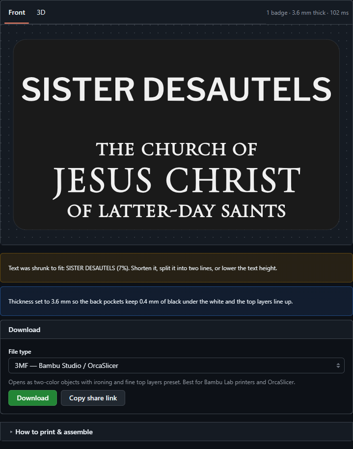

# ElderPrice3D — Missionary Name Badge Generator

> **Disclaimer:** this is an unofficial, independent, community-made project. It is
> **not made, endorsed, sponsored, or approved by**, and is **not affiliated with**,
> The Church of Jesus Christ of Latter-day Saints or Intellectual Reserve, Inc.

Generates a printable two-color 3-inch × 1.75-inch missionary name badge: the
name on top, the Church wordmark below, white under a thin black cap.

- **Website** (`docs/`, hosted on GitHub Pages): design single badges or batches
  with a live 2D/3D preview, and download 3MF (Bambu/Orca, PrusaSlicer, generic),
  STL or OBJ. Runs entirely in the browser.
- **Python CLI** (`generate.py`): the original generator, described below.



## Website

Static site in `docs/` — no build step. The geometry is a JavaScript port of
`badgegen/badge.py` (`docs/js/core/`) on [Manifold](https://github.com/elalish/manifold)
(WebAssembly), with [opentype.js](https://opentype.js.org/) for fonts,
[three.js](https://threejs.org/) for the 3D view, [fflate](https://github.com/101arrowz/fflate)
for 3MF/ZIP and [Primer CSS](https://primer.style/css) for the UI. Libraries are
pinned in `package.json` and copied into `docs/vendor/` (no CDN at runtime).

```bash
npm install
npm run vendor          # refresh docs/vendor/ after changing package versions
npm test                # Node: build badges + every export format
node tools/test-page.mjs  # headless Chrome: load page, preview, downloads
npm run serve           # http://localhost:8080
```

The default font is **Libre Franklin** (SIL OFL), an open Franklin Gothic revival —
Franklin Gothic itself is a commercial font and can't be redistributed. Users can
upload their own `.ttf/.otf/.woff` and SVG logo; uploads never leave the browser.

## What it makes

- **Size:** 3" × 1.75" (76.2 × 44.45 mm), ~2.6 mm thick — parametric.
- **Front:** upper half = title + name in a stencil font (auto-fit, centered);
  lower half = an SVG logo (the official Church wordmark ships in `assets/`).
- **Two-color, like engraved 2-ply plastic:** a full **white core** sits under a thin
  black cap (2 × 0.08 mm layers); the text/logo is cut through the cap to the white. Mill or
  engrave anywhere and white shows. `--letter-inserts` puts white only under the text/logo.
- **Fine top layers:** the 3MF carries a height-range modifier (`--top-layer 0.08`) for the
  top 0.4 mm, and the thickness is snapped to a 0.4 mm multiple so the white top and the
  badge top land exactly on layer boundaries. The rest prints at your profile's layer height.
- **Text face-up** (back on the plate) by default; `--face-down` for a textured-plate front.
- **Back:** `magnet` (default) — two pockets for 10×2 mm disc magnets plus a printed
  inside-the-shirt **backer** bar on the same plate; the shirt is clamped between them
  (no holes, no pin). `pin` — shallow channel for a stick-on bar pin. `blank`.
  The plate auto-thickens (≈3.2 mm for the deep pin slot, 3.6 mm for magnets) so pockets never reach the white inlay.
- **Ironing:** the badge object carries a per-object `ironing_type` (`--ironing top`
  default; `topmost`/`solid`/`none`), so your print profile isn't overwritten.

## Install

Python 3.10+ and:

```
pip install -r requirements.txt
```

(`trimesh`, `manifold3d`, `shapely`, `matplotlib`, `svgelements`, `numpy`, `mapbox_earcut`.)

## Usage

```bash
# Basic — writes output/elder_smith.3mf and .stl
python generate.py --line1 "ELDER SMITH"

# Your setup: 0.2 mm nozzle, with a PNG preview
python generate.py --line1 "ELDER SMITH" --nozzle 0.2 --preview

# Sister badge, magnet back
python generate.py --line1 "SISTER GARCIA" --back magnet

# Custom output path
python generate.py --line1 "ELDER NELSON" --out output/elder_nelson

# Several badges (+ magnet backers) on ONE build plate, one 3MF
python generate.py --plate "ELDER YAN" "ELDER JONES" "SISTER DESAUTELS" --nozzle 0.2
```

### Options

| Flag | Default | Meaning |
|------|---------|---------|
| `--title` | `ELDER` | Title line (e.g. ELDER, SISTER) |
| `--name` | `SMITH` | Name line (the large text) |
| `--logo` | `assets/church_logo.svg` | SVG for the lower half (`''` = none) |
| `--logo-grow` | `0.05` | Thicken thin logo strokes by N mm (outward buffer) |
| `--font` | `C:\Windows\Fonts\STENCIL.TTF` | Any `.ttf` font |
| `--back` | `magnet` | `magnet` \| `pin` \| `blank` |
| `--no-backer` | off | Magnet back: skip the inside-shirt backer |
| `--ironing` | `top` | `top` \| `topmost` \| `solid` \| `none` |
| `--nozzle` | `0.4` | Nozzle diameter for the min-stroke warning (use `0.2`) |
| `--width-in` / `--height-in` | `3.0` / `1.75` | Badge size (inches) |
| `--thickness` | `2.6` | Plate thickness (mm) |
| `--inlay-depth` | `0.8` | Two-color inlay depth from the front (mm) |
| `--preview` | off | Also save a PNG preview |
| `--no-stl` | off | Skip the combined STL |

## Printing (Bambu Studio + AMS)

1. Import the `.3mf`. It contains two objects: **body** and **inlay**.
2. Assign **inlay → white** filament, **body → black** (or your colors).
3. Orient **face-down** — the front (z=0 side) goes on the build plate for the
   matte texture. In Bambu Studio the object already has the front at the bottom.
4. Slice. Because the two colors are separate objects on the same first layers,
   you get crisp color separation with no manual paint or pause.

**Nozzle note:** the official wordmark is fine — at badge scale its thinnest
strokes are ~0.2 mm. With your **0.2 mm nozzle** that prints. On a 0.4 mm nozzle
the logo will look faint / lose color separation; the default `--logo-grow 0.05` thickens them to ~0.34 mm; go higher if needed, a bolder/
simpler logo, or a larger badge. The tool prints a warning when the thinnest stroke
is at/under your `--nozzle` value.

## Other languages (future)

The design is already language-ready:

- **Text:** pass a translated `--title`/`--name`. Use a `--font` that covers the
  script (the default STENCIL.TTF is Latin-only; supply a suitable `.ttf` for
  other scripts).
- **Logo:** pass the localized wordmark with `--logo path/to/localized.svg`. Any
  single-color SVG made of filled paths works.

## How it works

- `badgegen/text2poly.py` — TTF glyphs → shapely polygons (holes handled).
- `badgegen/svg2poly.py` — SVG (paths/shapes/transforms/curves) → shapely polygons.
- `badgegen/polygons.py` — even-odd ring builder, fit-to-box, min-stroke estimate.
- `badgegen/badge.py` — layout + solid modeling (manifold booleans), back features.
- `generate.py` — CLI and 3MF/STL/PNG export.

## Note on artwork

`assets/church_logo.svg` (also `docs/assets/`) is the Church wordmark, included
only so members can make personal missionary name badges. The Church's name and
wordmark are trademarks of Intellectual Reserve, Inc. This project is not
affiliated with or endorsed by the Church.
